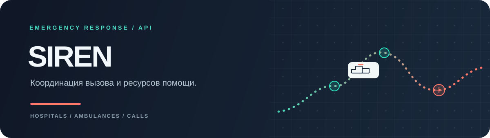
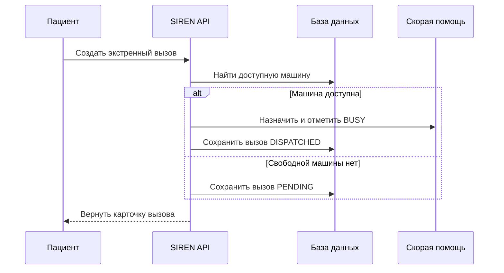

<div align="center">
  
  <br>
  
  
  
  
  <p><strong>Вызов принят. Ресурс назначен. Статус виден.</strong></p>
</div>

**SIREN** — backend API для учёта больниц, машин скорой помощи и экстренных вызовов. В проекте есть роли пациента, водителя, врача и администратора, JWT-вход и интерактивная документация.

## Сценарий диспетчеризации



Назначение в текущей реализации выбирает первую доступную машину; выбор по расстоянию не реализован.

## Маршруты

| Метод | Путь | Назначение |
|---|---|---|
| `POST` | `/api/accounts/register/` | Зарегистрировать пользователя и роль |
| `POST` | `/api/accounts/login/` | Получить JWT пару |
| `POST` | `/api/accounts/token/refresh/` | Обновить access токен |
| `GET/POST` | `/api/hospital/hospitals/` | Список больниц / создание |
| `GET/POST` | `/api/hospital/ambulances/` | Список машин / создание |
| `GET/POST` | `/api/hospital/calls/` | Просмотр или создание вызова |
| `GET` | `/api/docs/` | Swagger UI |
| `GET` | `/api/redoc/` | ReDoc |

При чтении вызовов пациент получает собственные записи, водитель — вызовы назначенной ему машины. Доступ к маршрутам дополнительно зависит от роли.

## Модель данных

```text
Hospital ──< Ambulance >── Driver
                  │
                  └──< EmergencyCall >── Patient
```

Вызов хранит координаты, описание симптомов, приоритет и статус. Машина имеет состояние `AVAILABLE`, `BUSY` или `MAINTENANCE`; у больницы ведётся число доступных мест.

## Запуск

```bash
python -m venv .venv
```

```powershell
.\.venv\Scripts\Activate.ps1
pip install -r requirements.txt
python manage.py migrate
python manage.py runserver
```

Откройте `http://127.0.0.1:8000/api/docs/` для Swagger UI. Локальные настройки проекта используют SQLite.

## Технологии

`Python` · `Django REST Framework` · `SimpleJWT` · `drf-spectacular` · `SQLite`
